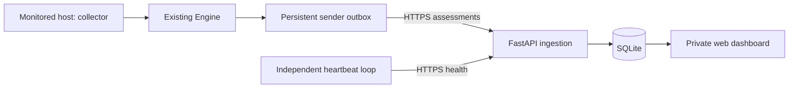

# Monitoring server handoff

## 1. Goal, current state and boundaries

Build the central web dashboard and authenticated ingestion API for the existing contextual Linux detector. The monitored machine runs collection and AIS inference; the server stores sanitized assessments, tracks monitoring availability and displays warnings. It never executes uploaded commands or trains from received attack activity.

Current code:

- `ais/engine.py`: `Engine.process(Event)` produces sanitized assessment dictionaries.
- `ais/events.py`: local normalization inspects arguments and paths, then discards them in favor of program names, path categories and rule facts.
- `ais/cli.py`: `score` and `audit-score` produce JSONL. Neither sends HTTP requests or heartbeats.
- `ais demo` creates three synthetic profiles and a 25-scenario correctness demonstration. Model quality remains experimental and not deployment-ready.

Deliver **v1 ingestion, storage and dashboard**, plus the small sender adapter needed for an end-to-end demonstration. Live collector deployment, online learning and remote model activation are subsequent integration work. Preserve the previously agreed candidate-review lifecycle; do not ship a working-looking learning toggle before agent support exists.

This handoff governs the v1 server contract where the broader implementation plan is less specific.



## 2. What crosses the network

V1 sends every nonduplicate sanitized assessment, including normal activity, so the operator can inspect surrounding events. It does not send only warnings. Start with one monitored VM, while storing multiple agents independently.

| Data | Contents |
|---|---|
| Transport identity | Authenticated agent identity, agent-run UUID, stable queued-record UUID, per-run sequence |
| Activity identity | Event ID, host, boot ID, username/account, role, effective/login UID, session and opaque service/lineage identifiers |
| Program context | Executable basename, parent basename, path category, sudo/wrapper flags, stage hints |
| Timing/context | Observed timestamp or null; supplied off-hours, new-source, new-destination and new-executable flags |
| Detection | Status, AIS score/threshold/alert/features/quality, separate Markov comparison, model version, first-seen/parent flags |
| Warnings | Rule ID, rule-or-AIS source, severity, reason, program-name evidence, group ID and cumulative count |
| Availability | Collector/detector/delivery health, queue/loss counters, heartbeat sequence and uptime |

**Do not upload:** argv, full command lines, raw shell histories, raw audit records, script contents, credentials, full executable/file target paths, actual login-source/destination IPs, training workflows, datasets, reference files or model detector arrays. Model version and quality metadata are enough for v1.

Hostnames, usernames and session/service identifiers are still operational metadata. The server also naturally observes the agent connection's network address; that address is not the attacker's login IP and must not populate `new_source`.

The sender must use an explicit field mapper rather than blindly uploading arbitrary JSON. Service/lineage identifiers must be opaque configured IDs, not raw cgroup/filesystem paths. A future full model/workflow upload would require its own reviewed contract.

### Assessment schema mapping

Retain the current `Engine.process` names and meanings. Use shared Pydantic contracts in `ais/contracts.py`, versioned independently of implementation details. Reject unknown fields recursively; finite numeric values only. Missing optional output keys become null at the mapper boundary, not zero/false.

- Identity: `event_id`, `host`, `boot_id`, `account`, `role`, `source`, `program`, `timestamp`, `uid`, `login_uid`, `session`, `service_id`, `lineage_id`, `parent_program`.
- Context: `stage_hints`, `path_kind`, `used_sudo`, `wrapper_opaque`, `coverage_notes`, `context`, `known_reference`, `model_version`, optional `first_seen_for_profile`, `unexpected_parent`, `sequence_reset`.
- Outcome: `status`, `ais`, `markov`, `warnings`.
- Status enum: `scored`, `warming_up`, `no_profile`, `missing_session_context`, `missing_features`, `duplicate`, `authentication_context`, `failed_execution`. The sender omits `duplicate` records from ingestion.
- `ais` is null before scoring. An AIS object can have null score/alert and populated `missing_features`; the Markov baseline may still be scored. Preserve this distinction.
- `source` is `exec`, `shell` or `auth`; warning source is separately `rule` or `ais`.
- Stage hints are explanations, not attack labels. Scores are not attack probabilities. A Markov alert does not automatically become an AIS warning.
- Current auth assessments do not expose each raw authentication outcome; do not infer it from a successful exec status or from a null AIS value.

Protocol bounds: 64 KiB per mapped item, 100 items and 1 MiB per HTTP batch. Identity strings max 256 characters; program basenames max 255 UTF-8 bytes; rule/group IDs max 128 characters; reason max 512 UTF-8 bytes. Warning evidence is the last ten program names, each bounded to 128 UTF-8 bytes. Clip display evidence only and list clipped field paths in the envelope's `truncated_fields`. Never truncate identity, sequence, scores or counts; invalid records go to a local rejection queue with a visible delivery fault.

### Example assessment batch

The assessment below is a shortened but valid object once nullable/defaulted optional fields are applied by the shared contract. It describes a Python attention warning during AIS warm-up, not a learned malicious verdict.

```json
{
  "schema_version": 1,
  "items": [
    {
      "record_id": "22222222-2222-4222-8222-222222222222",
      "run_id": "11111111-1111-4111-8111-111111111111",
      "sequence": 1,
      "type": "assessment",
      "truncated_fields": [],
      "assessment": {
        "event_id": "exec-123",
        "host": "vm-01",
        "boot_id": "boot-example",
        "account": "web",
        "role": "service",
        "source": "exec",
        "program": "python3",
        "timestamp": 1700000000,
        "uid": 33,
        "login_uid": null,
        "session": null,
        "service_id": "web.service",
        "lineage_id": null,
        "parent_program": "nginx",
        "path_kind": "system",
        "used_sudo": false,
        "wrapper_opaque": false,
        "stage_hints": ["privilege_escalation", "shell_tooling"],
        "coverage_notes": [],
        "context": {
          "off_hours": null,
          "new_source": null,
          "new_destination": null,
          "new_executable": null
        },
        "known_reference": true,
        "model_version": "aaaaaaaaaaaaaaaaaaaaaaaaaaaaaaaaaaaaaaaaaaaaaaaaaaaaaaaaaaaaaaaa",
        "status": "warming_up",
        "ais": null,
        "markov": null,
        "warnings": [
          {
            "rule": "python_attention",
            "source": "rule",
            "severity": "medium",
            "reason": "Python observed; review required independently of AIS normality",
            "evidence_programs": ["python3"],
            "group_id": "333333333333333333333333",
            "count": 1
          }
        ]
      }
    }
  ]
}
```

## 3. API, identity and delivery

### Authentication and runs

Provision each agent through an operator CLI with a display name and expected host identifier. Generate a random 256-bit bearer secret, show it once, and store only its SHA-256 hash. Use a public agent-ID prefix to locate the hash, then compare in constant time. Never select agent identity from a payload field. Token rotation/revocation is an operator action.

Agent requests use `Authorization: Bearer <token>` over HTTPS with certificate verification. The reported host must match its registration; a mismatch is a typed 409 error requiring registration/configuration correction.

On each process start, register a new random `run_id` with boot ID and mode `live`, `replay` or `demo`. Run registration is idempotent. A new run retires the previous current run and clears requested learning state. Re-registering a retired run must not make it current again.

| Endpoint | Contract |
|---|---|
| `POST /api/v1/agent-runs` | Register run UUID, boot ID, mode, agent version and capability flags; return authenticated agent ID and accepted run ID |
| `POST /api/v1/heartbeat` | Accept current-run health; return receipt time and learning-disabled state |
| `POST /api/v1/events` | Atomically ingest an assessment batch; return accepted record IDs, including already accepted identical retries |
| `GET /api/v1/agents` | Private dashboard agent summaries |
| `GET /api/v1/agents/{id}` | Latest health, run/model metadata, recent coverage statuses and outage history |
| `GET /api/v1/events` | Private paginated activity; filter by agent, account, time, source and assessment status |
| `GET /api/v1/alerts` | Private grouped warnings; filter by agent, rule, severity, source and acknowledgement |
| `POST /api/v1/alerts/{id}/acknowledge` | Private operator acknowledgement; idempotent |
| `GET /healthz`, `GET /` | Server/database readiness and private dashboard |

Use stable machine-readable error codes: 401 bad/revoked token, 409 wrong/retired run or identity/content conflict, 413 size limit, 422 schema error, 429/503 transient capacity failure. Validation errors return field paths/codes only: never echo received values or request bodies.

### Heartbeat contract

Send every 30 seconds from a loop independent of inference and event delivery. Fields:

- `schema_version`, `run_id`, `boot_id`, strictly increasing `heartbeat_seq`, nullable `sent_at` Unix timestamp, `uptime_seconds`.
- `collector`: mode (`audit`, `normalized_stream`, `replay`), state (`healthy`, `degraded`, `stopped`, `unavailable`), last successful poll timestamp, last observed event timestamp, collected/lost counters.
- `detector`: state (`running`, `unavailable`), model version or null, profile count, experimental/deployment-readiness flags.
- `delivery`: state (`healthy`, `degraded`), queue depth/bytes, persisted dropped-assessment/dropped-warning totals, last error code or null.
- `capabilities`: booleans for shell telemetry, authentication outcomes, source enrichment, learning and model activation. Do not claim capabilities merely because the inference schema accepts them.

Freshness uses **server receipt time**, not the agent clock. An identical retry can return 200 but cannot advance health time. Lower heartbeat sequences or retired-run heartbeats cannot refresh availability. Old queued assessments can still be accepted from a registered retired run without making the agent online.

Compute availability on reads and in a five-second transition sweep:

```text
if no accepted heartbeat: pending
else if now - last_fresh_heartbeat_received >= 90 seconds: unreachable
else if collector is not healthy or detector is unavailable
        or delivery is degraded: degraded
else: online
```

Online means reachable with functioning monitoring components, not safe or well-trained. Show model experimental status and per-context warm-up/missing-profile coverage independently. An idle collector is healthy when polling succeeds; a quiet stdin alone is insufficient proof. The future supervisor must supply real collector health. Replay/demo runs are visibly labeled and do not impersonate live collection.

### Sender/outbox contract

Add `ais/sender.py`; it accepts already sanitized assessments from the existing engine. Queue each record durably before attempting delivery. Persist its UUID, origin run and per-run sequence; retry the same envelope unchanged after a timeout/restart. Keep queued records from an earlier run tied to that earlier run.

- Flush at 100 items, 1 MiB or five seconds, whichever occurs first; warning records trigger an immediate flush attempt.
- Separate heartbeat requests from outbox delivery so backlog cannot hide collector failure.
- Retry network/429/5xx failures with exponential backoff and jitter, capped at 60 seconds; honor Retry-After.
- Pause on 401 until credentials are corrected. Quarantine 409/413/422 records, expose delivery degraded, and retain bounded rejection metadata without raw payload logging. These are not endless-retry failures.
- Delete only explicitly acknowledged record IDs. Use transactional SQLite outbox updates.
- Queue cap: 100,000 records or 256 MiB. Drop oldest nonwarning records first, then oldest warnings only if unavoidable; persist separate loss counters and report degradation. Never silently claim complete coverage.
- Persist collector checkpoints separately from delivery acknowledgements so HTTP retries do not require replaying kernel events.

The server uses a unique `(agent_id, record_id)` receipt and canonical payload digest. Same ID/same body is acknowledged without another write/group increment; same ID/different body returns 409. Validate the entire batch before a single atomic transaction. Dedup receipts remain for 90 days; this is bounded at-least-once/idempotent delivery, not a forever exactly-once guarantee.

## 4. Storage and dashboard

Use Python 3.12+, FastAPI, Uvicorn, Pydantic, HTTPX and Jinja2. Retain pytest for checks. Use standard-library SQLite with WAL, foreign keys and a 5-second busy timeout, one Uvicorn worker, and migrations tracked through `PRAGMA user_version`. Use bound SQL parameters and separate connections per request/task. No broker or JavaScript build pipeline is needed for v1.

Put server modules under `ais/server/` (app, storage, templates/static), shared contracts under `ais/contracts.py`, and transport under `ais/sender.py`. The server does not load the AIS model or call training functions.

Minimum tables:

| Table | Purpose and important keys |
|---|---|
| `agents` | UUID, display/expected-host identity, token hash, enabled/current-run state, latest accepted heartbeat snapshot and receipt time |
| `agent_runs` | Agent/run UUID, boot ID, mode, version/capabilities, registration/retirement times and heartbeat sequence |
| `ingest_receipts` | Unique agent/record UUID, canonical digest and received time for idempotency |
| `assessments` | Agent/run, record ID, sequence, observed/received times, indexed account/role/program/status/source and typed sanitized JSON |
| `alert_groups` | Unique agent/run/group/rule, source/severity, cumulative count, timestamps, latest evidence/sequence and acknowledgement |
| `health_transitions` | Previous/new state, server time and bounded static reason code |

Index activity by `(agent_id, received_at, id)` and warnings by agent/ack/severity/time. Default pagination: newest-first `(received_at, id)` cursor, 50 rows, max 200. Server receipt time breaks ties; observed time is separately available and can be unknown or skewed.

Default retention: normal assessment details 7 days; warning-linked assessments, warning groups, health transitions and dedup receipts 90 days. Keep current agent/run registration metadata. Run cleanup daily in batches. Back up SQLite with its backup API rather than copying a live database file while ignoring WAL.

### Warning grouping

The existing engine emits **cumulative** `count` values for a group, not increments:

```text
new group: insert warning and latest evidence
existing group:
    count = max(old count, incoming count)
    severity = max(old severity, incoming severity)
    keep observed-time min/max separately from receipt-time min/max
    update evidence only from a newer origin sequence
```

Acknowledgement persists as the group receives updates. A new group needs its own acknowledgement. Do not sum cumulative counts or let out-of-order delivery replace newer evidence.

**Current engine gap:** it emits warning observations, not explicit incident-resolution events. V1 displays recent/historical and acknowledged/unacknowledged warnings. A later normal score must not label a past credential/tamper event “resolved.” A future incident lifecycle needs a separate contract.

### Dashboard behavior

Poll private JSON endpoints every five seconds. Use Jinja autoescaping and DOM textContent; never render agent strings as trusted HTML.

- Overview: agent availability, last heartbeat age, collector/delivery state, queue/loss counters, current run mode and experimental-model badge.
- Agent detail: model/version, source capability limitations, latest per-context statuses and outage/recovery timeline.
- Warning feed: one feed with severity, account/role, rule/AIS source, reason, stage hints, grouped count, program evidence and acknowledgement.
- Activity: program-name trail and score/threshold details with missing features and Markov comparison available on expansion.
- Null score/warm-up/missing context renders “Not assessed,” not zero or “normal.” Keep intentional Python policy warnings distinct from AIS evidence in explanations.
- Show an explicit disconnected/stale-data banner after failed polling. An unreachable agent can mean shutdown/network loss/monitor failure/tampering; the UI must not assert compromise.
- No mobile/email integrations, command execution buttons, automatic blocking, or accuracy charts without labeled evaluation ground truth.

## 5. Deployment and delivery sequence

Default v1 is a single-operator private dashboard. Bind the application to 127.0.0.1; access the UI over an SSH tunnel. A TLS reverse proxy exposes only POST agent-run/heartbeat/event routes. Dashboard GET/admin mutation routes remain private. Agent bearer authentication must not grant dashboard/operator access.

Use a generated server secret, signed SameSite=Strict operator sessions, CSRF protection plus same-origin checks on dashboard mutations, an explicit allowed Host list, and no permissive CORS. Default FastAPI validation/access logging must not echo request bodies, bearer values or malformed input contents. The reverse proxy can log its network peer address; do not reuse it as a login-origin feature.

Persist the database on a private writable volume; provide environment-based server settings and restricted agent credential files. Add operator CLI commands for agent registration, token rotation and disabling an agent. Produce systemd and reverse-proxy examples as reviewable deployment files; do not modify a real VPS while building the prototype.

Implementation order:

1. Shared contracts and fixtures from actual `Engine.process` output, covering all statuses and warning sources.
2. SQLite migrations, agent provisioning/run registration, authenticated heartbeat/event ingestion and idempotency.
3. Private dashboard, warning upserts/acknowledgement, health transitions, retention and safe rendering.
4. Persistent sender adapter and replay/demo supervisor; demonstrate end-to-end with the existing synthetic event stream.
5. Live collector supervision/checkpoint integration and representative normal audit recordings on a VM. Do not claim this from replay success.
6. Add capability-gated learning/candidate controls in a subsequent version: off by default/restart/contact loss, active-versus-candidate separation, explicit review/activation/rollback. Keep these controls disabled/unavailable in v1; do not pretend the existing CLI already implements them.

## 6. Acceptance checks

- A synthetic stream from `ais demo` reaches a test server and renders in the warning/activity views with its run labeled demo. No listed command is executed.
- Every current assessment status validates; unknown keys/argv/raw targets, oversized bodies and nonfinite scores fail without echoing contents.
- Agent tokens are isolated; a disabled/wrong token cannot register, ingest or read another agent. Payload host identity cannot override registration.
- Retry/restart produces one stored assessment and one correct warning count; conflicting record reuse fails atomically. Out-of-order group updates cannot regress count, severity or evidence.
- Heartbeats at 30 seconds maintain reachability; after 90 seconds without a fresh heartbeat the agent is unreachable. Replayed/retired-run heartbeats and old event delivery cannot make it online.
- Collector stopped with sender alive shows degraded. Healthy polling with no commands stays online. Model warm-up/no-profile/experimental flags remain visible separately.
- Connection failure queues records; reconnect drains safely; queue limits/rejections/loss are surfaced. Sender supervision never fabricates collector health from idle input.
- UI acknowledgement is idempotent/CSRF-protected, agent strings are escaped, and failed polling displays stale state.
- Raw arguments, histories, IP origins, full paths, model arrays and secrets are absent from payloads, stored JSON, logs and rendered pages. Preserve program/user/host metadata explicitly intended for the dashboard.
- Server restart restores registrations, deduplication, acknowledgements and health calculations; retention/backup tests preserve warning evidence.

Run the existing detector suite before/after integration. Use FastAPI TestClient/HTTPX with a controlled clock and temporary SQLite database; avoid timing-based sleep tests. Final review includes a VM agent termination, collector failure and network interruption demonstration.
